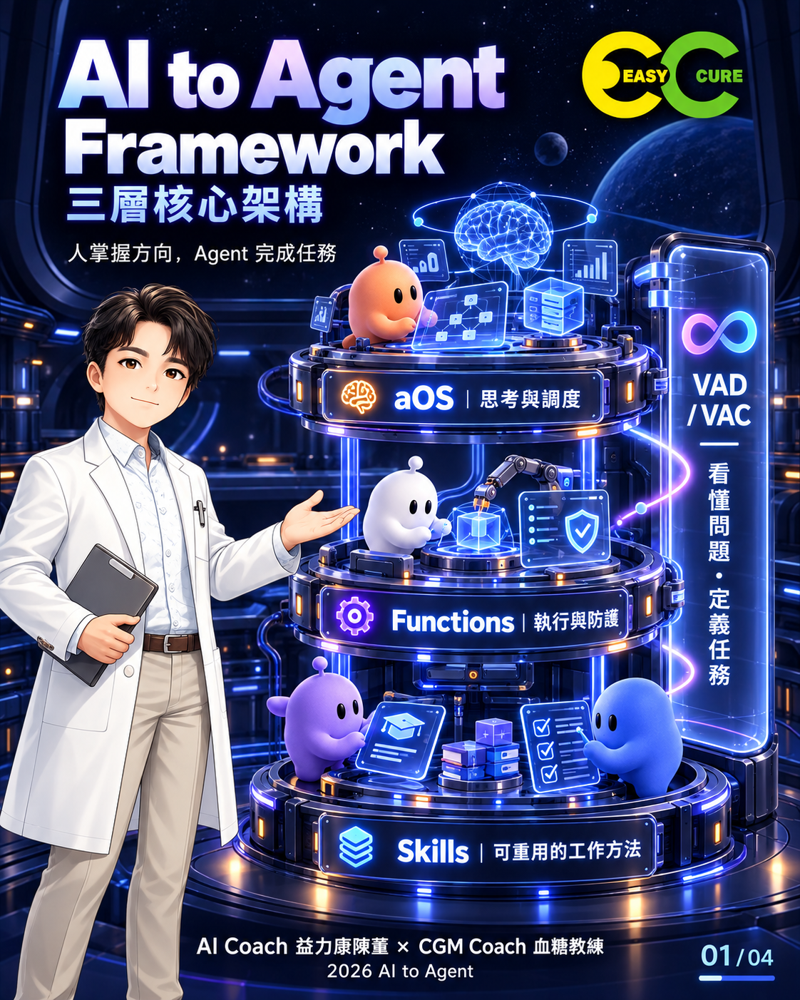

# AI to Agent Framework

用三層核心架構，連接人的目標與 Agent 的工作能力。

**aOS｜思考與調度 · Functions｜執行與防護 · Skills｜可重用的工作方法**

VAD／VAC 是橫跨三層的任務藍圖。人掌握方向，Agent 完成任務。

## 專案定位

本專案協助企業主管、講師與實作者，把分散的模型、工具與工作方法整理為清楚的分工。主類型是方法論，附教學圖卡與示範案例；不是可安裝的 Agent 軟體，也未提供自動調用三家平台的執行程式。

| 主體 | 責任 | 內容 |
|---|---|---|
| aOS | 理解與協調 | 人的方向、模型推理、任務調度、記憶 |
| Functions | 實際操作與邊界 | Tools、MCP 連接、檢查、權限 |
| Skills | 指導工作做法 | 業務步驟、判斷原則、品質要求 |

這是分工架構，不是固定的 aOS → Functions → Skills 執行順序。aOS 依任務選擇 Skill，並協調 Functions 執行；VAD／VAC 提供共同規格。ChatGPT、Gemini、Claude 是可選能力來源，不要求全部啟用。驗收與案例服務於任務，不增加架構層。

## 快速開始

不需安裝程式。下載本專案，依序：

1. 閱讀 [核心架構](docs/architecture.md) 與四張圖卡。
2. 複製 [VAC 空白範本](templates/vac.md)，填寫素材、目標、限制及驗收條件。
3. 參照 [使用指南](docs/usage.md)，選擇現有可用的模型、Skill 與工具。
4. 閱讀 [三十秒短影片案例](examples/short-video.md)，安排實際工作。
5. 檢查交付物，把有效做法整理為可重用 Skill。

輸入：任務藍圖、素材、限制、可用能力。輸出：任務成品、驗收結果與可重用工作方法。驗收以 VAC 為準，不以回覆文字或計畫代替實際成品。

## 適用範圍

適合企業工作設計、AI 課程、內容製作、研究整理與知識工作。未配置工具、權限或執行環境時，不能視為已具備自動執行能力；本專案不宣稱任何效能、成本或多模型實測結果。

## 圖卡

| 頁碼 | 圖片 | 重點 |
|---|---|---|
| 01/04 | [總覽](assets/cards/01-overview.png) | 三層核心＋陳董形象 |
| 02/04 | [aOS](assets/cards/02-aos.png) | 思考與調度 |
| 03/04 | [Functions](assets/cards/03-functions.png) | 執行與防護 |
| 04/04 | [Skills](assets/cards/04-skills.png) | 可重用工作方法 |

圖卡採「星艦協作 3D 霓虹科技風」。圖像是概念說明，不是部署拓撲；文字定義以本專案文件為準。

## 檔案導覽

- [架構與名詞](docs/architecture.md)、[使用指南](docs/usage.md)
- [視覺規格與圖卡文字](docs/visual-style.md)
- [社群介紹](docs/social-post.md)
- [短影片案例](examples/short-video.md)、[VAC 範本](templates/vac.md)
- [素材來源](assets/SOURCES.md)、[版權聲明](COPYRIGHT.md)、[授權狀態](LICENSE)
- [貢獻指南](CONTRIBUTING.md)、[變更紀錄](CHANGELOG.md)
- [GitHub 上傳指南](docs/publishing.md)、[Release Notes](RELEASE_NOTES.md)
- [檢查報告](docs/release-check.md)、[檔案雜湊](SHA256SUMS.txt)

## 版本與後續

版本：0.1.0；日期：2026-09-28；狀態：首版方法論教材草稿，保留所有權利。機器可讀中繼資料見 [project.json](project.json)（版本以 [VERSION](VERSION) 為單一來源）。本版依本次對話收斂內容建立，不宣稱合併或取代任何未提供的既有 repository。

後續以真實任務回饋修正文案及 Skill，不預設新增架構層或多模型測試系統。

## 授權與署名

本 repo 採保留所有權利（All rights reserved），詳見 LICENSE、COPYRIGHT.md 與素材來源聲明。品牌署名不等於法律權利人推定，法律權利人見 COPYRIGHT.md。

**AI Coach 益力康陳董 x CGM Coach 血糖教練 | 2026 AI to Agent**
